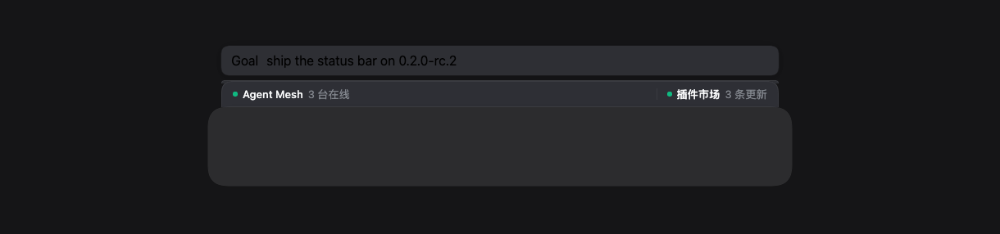
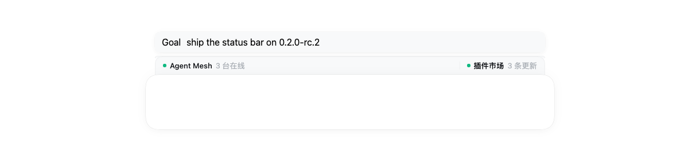

<div align="center">

# dsh-plugin-status-bar 📊

**在输入框上方留一条状态条，让其它插件把「当前状态」放到它该在的地方。**

[安装](#安装) · [它做什么](#它做什么) · [注册一个段](#注册一个段) · [几何是怎么定的](#几何是怎么定的) · [样式契约](#样式契约) · [已知边界](#已知边界) · [开发](#开发)

[](https://www.npmjs.com/package/dsh-plugin-status-bar) · [](LICENSE) · 

</div>



DSH 的输入框上方有一条**比输入卡片略窄、居中、与卡片上沿贴合**的横条位置（宿主槽位
`conversation.input.dock`）。这个包把它做成一个**通用容器**：它自己不含任何业务逻辑、一个段都不注册，
只对外提供一个注册面，任何客户端插件都可以往里放自己的状态段。

于是"当前用的是哪台机器""插件市场有几条更新""这轮测试过了几条"这类**一直该看得见、又不值得占一段对话**
的信息，有了统一的落点——样式一致、位次不打架、主题跟着宿主走。

> 当前版本 `0.2.1` · DSH 客户端插件 · 零运行时依赖 · 对着 **DSH 0.2.0-rc.2** 核对过几何与令牌

## 安装

```bash
dsh plugin --profile desktop add dsh-plugin-status-bar
```

`--profile` 填你实际在用的那个（桌面端是 `desktop`，Web 端是 `web`）。**重启 DSH 生效**——
客户端半体是启动时加载的。

这条命令背后是 pnpm：装完包之后，它会**自动**把声明了 `dsh.bundle` 的依赖加进 profile 的
`dsh.profile.bundles`——不用手改 `package.json`。

| 从哪装 | 命令 |
| --- | --- |
| npm（推荐） | `dsh plugin --profile desktop add dsh-plugin-status-bar` |
| GitHub 最新提交（还没发版的改动） | `dsh plugin --profile desktop add github:vianvio/dsh-plugin-status-bar` |
| 本地目录（改代码即时生效，用来开发） | `git clone https://github.com/vianvio/dsh-plugin-status-bar.git ~/dsh-plugin-status-bar`<br>`dsh plugin --profile desktop add link:$HOME/dsh-plugin-status-bar` |

以后升级、卸载：

```bash
dsh plugin --profile desktop update dsh-plugin-status-bar
dsh plugin --profile desktop remove dsh-plugin-status-bar
```

> **升级 DSH 大版本后状态条"消失"了？** 先看插件管理器给的那行提示。宿主 preflight 会读
> `peerDependencies` 里的 `@deepseek-ai/dsh*` 区间，不满足时会把整行**禁用**（不是崩，是静默缺席，
> 更难查）。本包声明的是 `>=0.2.0-rc.2 <0.3.0-0`。

## 它做什么

| 谁 | 做什么 |
| --- | --- |
| **本插件** | 维护那条横条：宽度/圆角/材质/贴合全部按宿主令牌算；提供 `inputStatusBar` 注册面 |
| **使用方插件** | 往注册面里 `register()` 自己的段——数据驱动（容器渲染标准触发器与面板外壳）或自带组件 |

- **没有段时整条容器不渲染**，不会在输入框上方留一条空壳占位。
- 段之间自动插 1px 分隔线；`align: "end"` 的段被推到横条右侧。
- 同一时刻只展开一个面板；Esc / 点击外部关闭；`↑` `↓` 在面板项之间移动焦点。
- 使用方插件被回收时，它注册的段自动注销。

## 注册一个段

```js
// 你的客户端插件 client.js
window.__ModuleLoader__.load({
  id: "your-plugin",
  factory: (require) => {
    var module = { exports: {} };
    var exports = module.exports;
    var react = require("react");

    function CafeSegment(props) {
      return react.createElement(props.Segment, {
        id: "cafe",
        open: props.open,
        onToggle: props.toggle,
        title: "咖啡",
        menu: props.open ? react.createElement("div", { className: "dshStatusHint" }, "面板内容") : null,
        menuAvailable: true
      },
        react.createElement("span", { className: "dshStatusDot", style: { background: "#f59e0b" } }),
        react.createElement("span", { className: "dshStatusLabel" }, "咖啡"),
        react.createElement("span", { className: "dshStatusText" }, "2 杯")
      );
    }

    exports.name = "your-plugin";
    exports.inject = ["inputStatusBar"];
    exports.apply = (ctx) => {
      ctx.effect(() => ctx.inputStatusBar.register({
        id: "cafe",
        order: 120,
        component: CafeSegment
      }));
    };
    return module.exports;
  }
});
```

也可以完全走数据驱动（容器渲染标准触发器与面板外壳，你只给数据）：

```js
ctx.inputStatusBar.register({
  id: "market",
  order: 200,
  align: "start",                 // "end" 表示右对齐组
  label: "插件市场",
  status: "3 条更新",
  tone: "pass",                   // idle | running | pass | warn | fail
  dot: true,
  menu: MarketPanel,              // 组件：{ item, bar, host, close, toggle }
  onSelect: (api) => {},          // 无 menu 时的点击行为
});
```

### 注册面 API

| 方法 | 说明 |
| --- | --- |
| `register(item)` | 注册段，返回注销函数；`id` 必填且唯一；段上限 16 |
| `unregister(id)` | 按 id 注销 |
| `update(id, patch)` | 浅合并更新一个段（命中返回 `true`） |
| `list()` | 当前段快照（已按 `order` 升序） |
| `subscribe(fn)` | 订阅变更，返回退订函数 |
| `revision()` | 变更计数（调试用） |

段按 `order`（默认 100）升序排列，同序按 `id` 排序；空间不足时收缩省略
（`text-overflow: ellipsis`），不换行、不横向滚动。

拿不到 `ctx` 的集成方可以走 `window.__DSH_INPUT_STATUS_BAR__`——它和 cordis 服务指向**同一个**注册面。

## 几何是怎么定的

尺寸不写死，全部由宿主 composer 自己的令牌推出来（宿主调版面时状态条跟着走）：

| 依赖的宿主令牌 | 0.2.0-rc.2 | 用途 |
| --- | --- | --- |
| `--dsh-composer-side-clearance` | `16px` | 输入卡片距 composer 栈边缘的留白 |
| `--dsh-composer-dock-inset` | `8px` | dock 面板相对卡片边缘的内缩单位 |
| `--dsh-composer-card-max-width` | `content-width + 32px` | 输入卡片宽度上限 |
| `--dsh-composer-stack-gap` | `6px` | 被负 margin 吃掉，让条体贴住卡片上沿 |
| `--dsw-radius-lg` · `--dsw-specific-menu` · `--dsw-menu-backdrop-filter` | 主题提供 | 圆角、表面材质、背板滤镜 |

推导式：**相对 composer 栈边缘内缩 `side-clearance + 2 × dock-inset`**，也就是相对输入卡片边缘
内缩 `2 × dock-inset`——与宿主自己的 `GoalBar` / `QueueDock` / `TodoPanel` 在同一槽位里的落位完全一致
（它们分别用 `4 × dock-inset`、`2 × dock-inset + padding` 达到同一个效果）。

想自己调宽窄，覆盖 `--dsh-status-bar-inset` 即可（相对 composer 栈边缘，上面那套推导只作兜底）。

表面走宿主 dock 面板同一套材质，所以浅色主题下不会变成一条灰带：



> 上面两张图不是画的：`npm run render` 把**本机 DSH 里那份真的 composer CSS 与设计令牌**抽出来排版，
> 塞进插件真渲染出来的标记，再用无头 Chrome 量真实盒模型并截图——同一份产物就是那 81 条几何断言的依据。

## 样式契约

容器外壳（由本插件渲染，段不要覆盖）：

| 类名 | 用途 |
| --- | --- |
| `.dshStatusDockRow` | 挂载行：宽度/上限按宿主令牌推导、居中、吃掉堆叠间距贴住输入卡片 |
| `.dshStatusBar` | 整条容器（`role="toolbar"`）：宿主 dock 面板材质、仅顶部圆角、接缝不描边 |
| `.dshStatusSeg` / `.dshStatusSegEnd` | 段外壳（`position: relative`，面板以此为锚） |
| `.dshStatusSegButton` / `.dshStatusSegStatic` | 段触发器（可点击 / 静态） |
| `.dshStatusSegBody` | 段内容容器 |
| `.dshStatusChevron` / `.dshStatusChevronOpen` | 面板箭头（展开旋转 180°） |
| `.dshStatusPanel` | 面板外壳（向上展开、宿主菜单底色与投影） |

段内容与面板内容可直接复用的公开积木：

| 类名 | 用途 |
| --- | --- |
| `.dshStatusDot` / `.dshStatusDotPulse` | 状态点 / 脉冲动效 |
| `.dshStatusLabel` / `.dshStatusText` | 主文案 / 次要文案 |
| `.dshStatusHead` / `.dshStatusBadge` | 面板标题行 / 徽标 |
| `.dshStatusRow` / `.dshStatusRowLabel` / `.dshStatusRowValue` | 面板信息行（label 左、value 右） |
| `.dshStatusSep` | 面板分隔线 |
| `.dshStatusCell` / `.dshStatusCellValue` / `.dshStatusCellValueOk` | 面板动作项（配 `role="menuitem"`） |
| `.dshStatusHint` | 面板底部说明文字 |

主题令牌：表面、圆角、描边与交互色全部走宿主 `--dsw-*` 变量并提供回退值。

| 可调变量 | 默认 | 含义 |
| --- | --- | --- |
| `--dsh-status-bar-inset` | `side-clearance + 2 × dock-inset` | 相对 **composer 栈**边缘的每侧内缩 |
| `--dsh-status-bar-height` | `32px` | 条高 |

## 已知边界

- **只负责输入卡片上方那一条。** 卡片内部的工具行（模型选择、权限、附件）属于宿主的
  `conversation.composer.dock`，本插件不碰——两边同时抢位次会让输入框抖动。
- **它是基础设施，不认识任何业务。** 段的文案、颜色语义、面板内容都由使用方决定；
  本包只保证外壳、交互与主题一致。
- **容器几何依赖宿主的 `--dsh-composer-*` 令牌。** 宿主哪天改掉这些名字，宽度会退回回退值——
  `npm run compat` 就是用来当场抓到这件事的。
- **`render` 需要本机装有 DSH。** 它要读 `app.asar` 里的真实 CSS 与令牌；没装会明确报错，
  不会静默跳过。

## 开发

产物就在仓根、**没有构建步骤**：`client.js` 是页面按 `<script src>` 加载的经典脚本；`index.js` 是
宿主半（空 `apply`，只为让这个包在 Loader 里有一个条目，客户端产物才会被编进 `__DSH_BOOT__`）。
零运行时依赖。

```bash
npm test            # 发布契约（package.json 里那几行声明）
npm run verify      # 静态契约：导出面 / 几何推导式 / 样式原语 / 无障碍 / 注册面 API
npm run compat      # 对着**本机安装的 DSH** 查槽位、位次、令牌、清单、版本区间
npm run smoke:client# react-dom/server 离线渲染体检
npm run render      # 真浏览器：宿主真 CSS + 真令牌里排版，量真实盒模型并出截图
npm run gate        # 上面全部
```

`npm run render` 需要 Chrome 与 react（`CHROME_BIN` / `DSH_REACT_ROOT` 可指定）。
`compat` 与 `render` 都**不抄宿主的 CSS**，而是从 `app.asar` 现读（`DSH_ASAR` 可覆盖）——
所以宿主一改版面/令牌，这两条命令会立刻变红，而不是等到界面上看着别扭才发现。

机制细节、0.2.0 修掉的四处漂移、以及几个容易复刻错的坑，都在 [`docs/notes.md`](docs/notes.md)。

发版：先 `npm version`，再 `npm publish`，最后 `git push --follow-tags`。

## 许可

MIT
